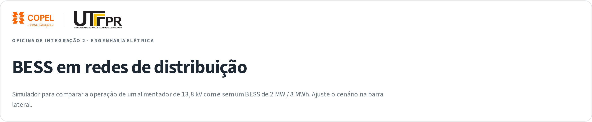

# BESS Dashboard — COPEL/UTFPR

Interactive Streamlit dashboard to simulate the operation of a battery energy storage system (BESS) in a 13.8 kV distribution network. The project presents power flow, SOC, voltage, consumption, losses, economic viability, and a reference single-line diagram of the substation.



## Requirements

- Python 3.10 or newer
- `pip` and `venv`
- Linux, WSL, or Windows with Git Bash to run `run.sh`
- On native Windows (PowerShell/CMD), use the manual commands below

## Linux

```bash
cd /path/to/project
chmod +x run.sh
./run.sh
```

On the first run, the script creates `.venv` and installs the dependencies. It then starts Streamlit at `http://localhost:8501`.

## Windows

`run.sh` is a Bash script. On Windows, use one of the options below.

### Option 1: WSL (recommended)

```bash
cd /mnt/c/Users/YOUR_USER/path/to/project
chmod +x run.sh
./run.sh
```

### Option 2: Git Bash

```bash
cd "/c/Users/YOUR_USER/path/to/project"
chmod +x run.sh
./run.sh
```

### Option 3: PowerShell/CMD without Bash

```powershell
py -m venv .venv
.\.venv\Scripts\python.exe -m pip install --upgrade pip
.\.venv\Scripts\python.exe -m pip install -r requirements.txt
.\.venv\Scripts\python.exe -m streamlit run app.py
```

If `py` is unavailable, replace it with `python`.

## Access

After starting, open:

```text
http://localhost:8501
```

To stop, press `Ctrl+C` in the terminal.

## What run.sh does

1. Enters the project directory.
2. Checks whether `.venv` exists; if not, creates it and installs `requirements.txt`.
3. Starts Streamlit with `app.py`.

## Troubleshooting

- **`python3: command not found`**: install Python 3. On Debian/Ubuntu, run `sudo apt install python3 python3-venv`.
- **`Permission denied` when executing**: run `chmod +x run.sh`.
- **Port 8501 already in use**: use another port with `.venv/bin/python -m streamlit run app.py --server.port 8502` on Linux/WSL. On Windows, use `.\.venv\Scripts\python.exe -m streamlit run app.py --server.port 8502`.
- **Windows without Bash**: use option 3 (PowerShell/CMD) or install WSL/Git Bash.
- **Outdated dependencies**: delete `.venv` and run the script again.

## Structure

```text
app.py                  Streamlit interface
bess/model.py           Simulation and calculations
bess/charts.py          Plotly charts and single-line diagram
bess/styles.py          Theme and visual components
assets/                 COPEL and UTFPR logos
prints/                 Screenshots for slides
.streamlit/config.toml  Streamlit theme and configuration
requirements.txt        Python dependencies
run.sh                  Startup script for Linux/WSL/Git Bash
```
